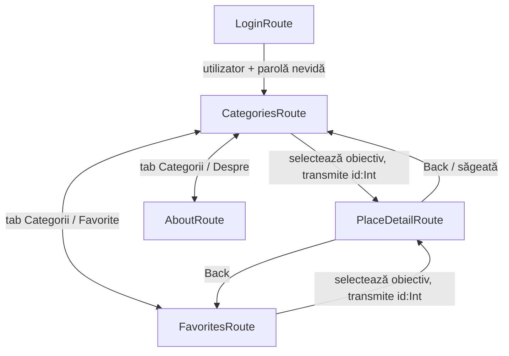

# Visit Maramureș

Aplicație Android demonstrativă pentru tema CMO – Laboratorul 05.

## Tehnologii
- Kotlin
- Jetpack Compose + Material 3
- Navigation Compose 2.8.5
- Kotlin Serialization pentru rute type-safe

## Rulare
1. Deschide Android Studio.
2. Alege **Open** și selectează folderul `VisitMaramures`.
3. Așteaptă sincronizarea Gradle.
4. Pornește un emulator Android (API 26 sau mai nou) sau conectează un telefon.
5. Apasă Run.

## Date de autentificare
Autentificarea este simulată. Orice utilizator și parolă necompletate sunt acceptate.

## Diagrama fluxului de navigare

- Login este eliminat din back stack cu `popUpTo<LoginRoute> { inclusive = true }`.
- Ecranul de detaliu primește doar `id: Int`, apoi citește obiectul din `PlacesRepository`.
- Ecranele nu primesc `NavController`; navigarea este transmisă prin lambda-uri.
- `selectedCategory` și favoritele folosesc `rememberSaveable`.
- Tab-urile folosesc `saveState`, `restoreState` și `launchSingleTop`.

## Date demonstrative
Aplicația conține 9 obiective: 3 Sport, 3 Muzee și 3 Restaurante. Verifică înainte de predare descrierile și datele locale și completează numele autorului în ecranul Despre.
